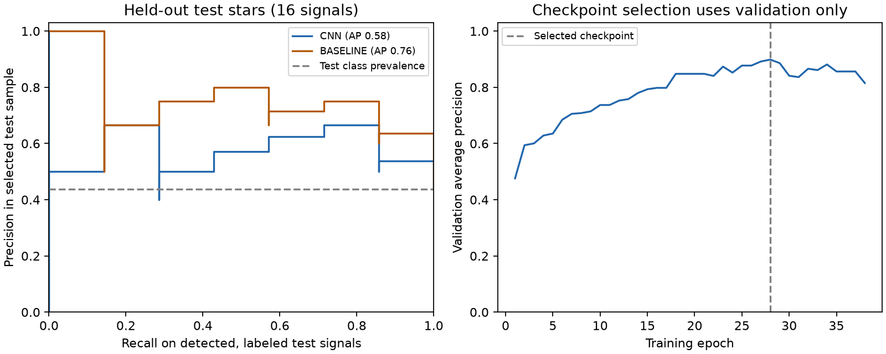
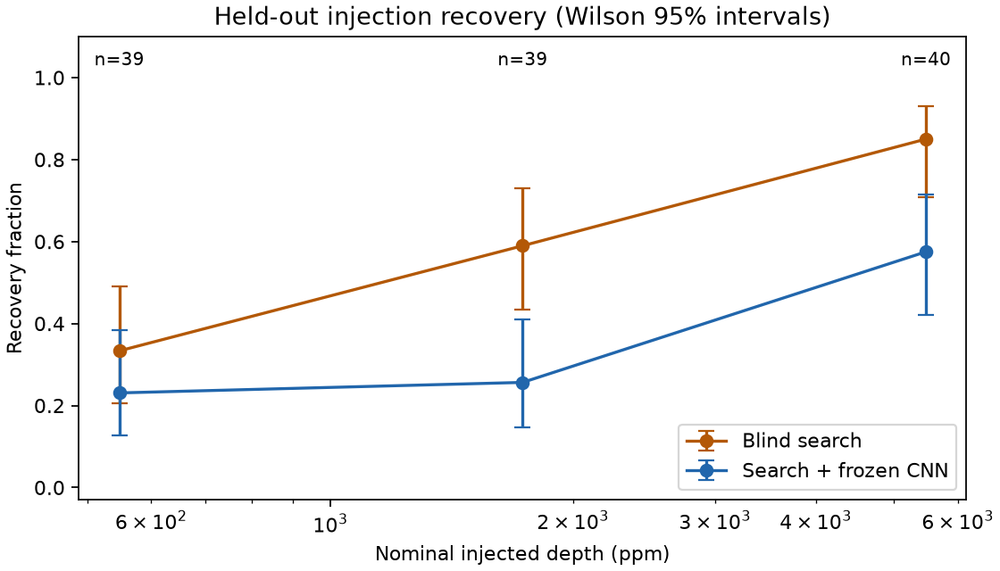

# TESS confirmed-label starter experiment

Run: `runs/tess-learning-starter`. This is a small initial experiment with frozen validation-selected thresholds.

| Model | Test PR-AUC | Test ROC-AUC | Planet recall | False-positive rate |
| --- | ---: | ---: | ---: | ---: |
| CNN | 0.581 | 0.683 | 71.4% | 33.3% |
| BASELINE | 0.760 | 0.825 | 85.7% | 22.2% |

Test set: 7 confirmed-planet signals and 9 FP/FA signals on 16 stars. These classification metrics cover detected, conservatively matched signals, not all planets on these stars.

The CNN has 41,057 parameters. 532 signals remained unlabeled and were scored without entering training.

On test stars the blind search matched 7/14 catalog-confirmed signals with periods in the search range and at least two sampled events. Nonmatches include search misses and conservative timing/alias exclusions.

Injection evaluation used 120 trials on 26 held-out stars. Of 118 eligible trials, blind search recovered 70 and the frozen CNN selected 42. Transits were inserted before cleaning into real PDCSAP flux; this does not test pixel extraction or SPOC correction. The plotted Wilson intervals describe individual trials; repeated stars create dependence, so these are not intervals for population completeness.

Scores are uncalibrated rankings. Precision describes this selected sample, not survey candidate yield. The sample is too small to establish robust discovery performance or a scaling law. Unlabeled detections require catalog updates and scientific vetting before claiming novelty.

See [the pipeline guide](../../docs/learning_pipeline.md) for reproduction commands, label rules, data products, configuration and limitations.

The saved pipeline also searched 100 independent stars and ranked 300 signals in [discovery_search.csv](discovery_search.csv). These are an inference exercise, not verified new planets. Catalog-matched KP/PC/APC signals may be excluded from supervised training while still carrying their known catalog disposition.
