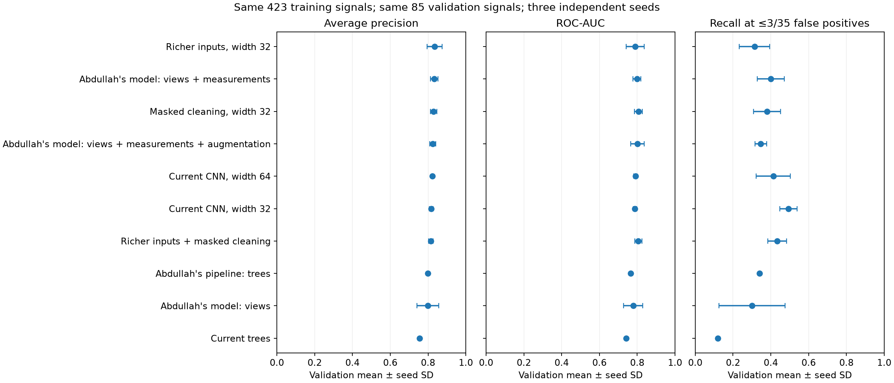
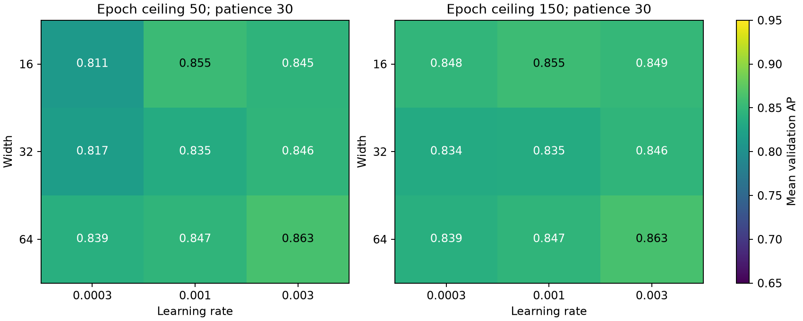
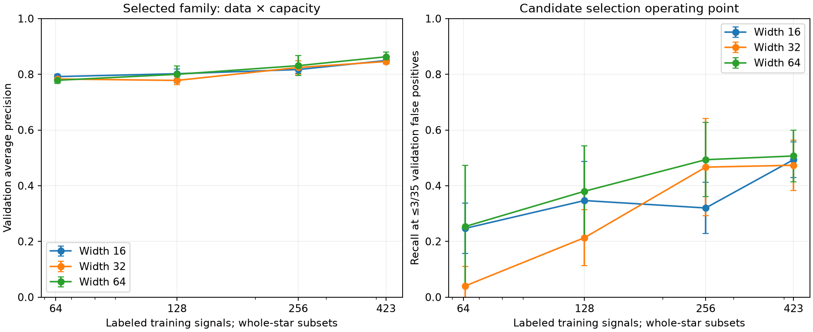

# Controlled TESS representation comparison

All models train on the same 423 CP/FP/FA signals and validate on the same 85 signals (50 confirmed planets, 35 FP/FA), with stars kept in separate partitions. The source is the previous scaling dataset. Test signals are excluded even from view preparation.

Abdullah's pipeline refers to [06_train_shape_model.py](../../tls_masked_search/06_train_shape_model.py) (without its pixel images) and its associated data/view stages. Its neural variants are referred to as Abdullah's model.

| Model | Parameters | Validation AP ± seed SD | ROC-AUC | Recall at ≤3/35 FP | Mean fit seconds |
| --- | ---: | ---: | ---: | ---: | ---: |
| Richer inputs, width 32 | 260,193 | 0.835 ± 0.040 | 0.789 | 31.3% | 3.7 |
| Abdullah's model: views + measurements | 101,921 | 0.833 ± 0.019 | 0.798 | 40.0% | 2.3 |
| Masked cleaning, width 32 | 160,961 | 0.829 ± 0.017 | 0.807 | 38.0% | 2.9 |
| Abdullah's model: views + measurements + augmentation | 101,921 | 0.825 ± 0.016 | 0.801 | 34.7% | 2.9 |
| Current CNN, width 64 | 637,313 | 0.823 ± 0.004 | 0.790 | 41.3% | 3.2 |
| Current CNN, width 32 | 160,961 | 0.817 ± 0.010 | 0.788 | 49.3% | 2.8 |
| Richer inputs + masked cleaning | 260,193 | 0.815 ± 0.012 | 0.806 | 43.3% | 3.9 |
| Abdullah's pipeline: trees | — | 0.800 ± 0.000 | 0.766 | 34.0% | 4.3 |
| Abdullah's model: views | 98,849 | 0.800 ± 0.058 | 0.778 | 30.0% | 2.7 |
| Current trees | — | 0.756 ± 0.000 | 0.741 | 12.0% | 2.3 |

## What changed

Current CNN: the original full-orbit, transit-close-up and individual-event views, with flux, uncertainty and occupancy channels and four basic scalar measurements.

Masked cleaning: exactly the current quality/gap/window recipe, but fits the flattening trend while masking the blind candidate's transit windows. It receives no catalog ephemeris.

Richer inputs: adds separate odd/even and phase-0.5 close-ups, signed X/Y centroid residuals, and SAP/PDCSAP full-orbit views with a three-times-longer flattening window. Each observational series has uncertainty and occupancy channels. Odd/even/secondary fluxes share the same normalization to retain their relative depths. Richer models use four basic scalars, without the diagnostic feature vector from Abdullah's pipeline.

Abdullah's model: uses the original step-4 snapshot code on this same single FITS sector, including its masked flattening, depth normalization and missing-bin interpolation. At width 16, its architecture and predictions for identical weights match Abdullah's model in step 6 (without pixel images) exactly. The hybrid adds the original twelve measurement definitions and missing flags; one-sector/chunk rates are adapted accordingly. The views-only comparison isolates the feature vector within this architecture.

All neural fits use the same weighted binary loss, AdamW, batch size 32, learning rate 0.001, weight decay 0.01, AP checkpoint criterion, 100-epoch ceiling and patience 20. The augmentation from Abdullah's pipeline is a separate variant. This replaces Abdullah's original five-seed ensemble and cross-validation recipe with the shared protocol. Models differ in parameter count and architecture; this is not an equal-FLOP comparison.

All 508 prepared signals have usable centroid measurements. View-validity flags from Abdullah's pipeline are true for 486/508 signals; no variant drops rows based on those flags, keeping cohorts identical.

The current tree baseline and the tree baseline from Abdullah's pipeline differ in feature set and original hyperparameters; both are trained on the same clean rows. No unmatched signals are treated as negatives.

## Paired validation contrasts

The differences below average individual-model AP differences across the same three seeds. Intervals resample validation stars in pairs with models fixed. They are exploratory 90% intervals, do not account for repeated validation checkpoint/model selection, and are not independent test estimates.

| Comparison | Mean AP difference | Paired star interval |
| --- | ---: | ---: |
| Current CNN, width 64 minus Current CNN, width 32 | +0.006 | [-0.033, +0.049] |
| Masked cleaning, width 32 minus Current CNN, width 32 | +0.013 | [-0.025, +0.050] |
| Richer inputs, width 32 minus Current CNN, width 32 | +0.018 | [-0.026, +0.059] |
| Richer inputs + masked cleaning minus Masked cleaning, width 32 | -0.014 | [-0.072, +0.054] |
| Abdullah's model: views + measurements minus Abdullah's model: views | +0.033 | [-0.005, +0.066] |
| Abdullah's model: views + measurements + augmentation minus Abdullah's model: views + measurements | -0.008 | [-0.029, +0.014] |
| Abdullah's model: views + measurements minus Current CNN, width 64 | +0.010 | [-0.040, +0.055] |

## Follow-up scaling

The selected comparison variant was **Richer inputs, width 32**, by mean validation AP. We evaluated three widths, learning rates 0.0003/0.001/0.003, and 50/150-epoch ceilings across three seeds (54 fits). The recipe with highest AP averaged across widths/seeds used learning rate 0.003 and epoch ceiling 150. This recipe then used nested whole-star subsets of 64, 128, 256 and 423 signals (36 fits).

| Width | Parameters | Full-data validation AP ± seed SD | ROC-AUC | Recall at ≤3/35 FP |
| --- | ---: | ---: | ---: | ---: |
| 64 | 1,024,193 | 0.863 ± 0.017 | 0.817 | 50.7% |
| 16 | 67,121 | 0.849 ± 0.012 | 0.812 | 49.3% |
| 32 | 260,193 | 0.846 ± 0.004 | 0.819 | 47.3% |

Selection is adaptive on the same validation stars. These are development results; the largest score after tuning is optimistic. Epoch ceilings allow early stopping and do not guarantee additional compute was used. Exact epochs, updates, cap flags and timing are saved per fit. Each seed is an individual model, not a three-model ensemble.

The full-data-selected training recipe is fixed across smaller subsets. At 64 training signals, some wider models produce tied scores at 1.0; the conservative threshold then accepts fewer than the allowed three false positives, sometimes rejecting every signal. The operating-point curves therefore show performance under an FP ceiling, not an exact matched FP count. See per-fit FPRs in the results tables.

## Scope and reproduction

This experiment isolates representation and model/training changes using existing single-sector detections. It does not measure multi-sector gains, increase the clean catalog-label pool, change blind TLS candidate generation, or re-evaluate end-to-end injection recovery. All scores are uncalibrated rankings; no result establishes a newly discovered planet.

Run instructions and interpretation: [controlled experiment guide](../../docs/controlled_experiment.md). The audit checks whole-star splits, identical/nested subsets, saved metrics and checkpoint reloads; see [audit.json](audit.json).
