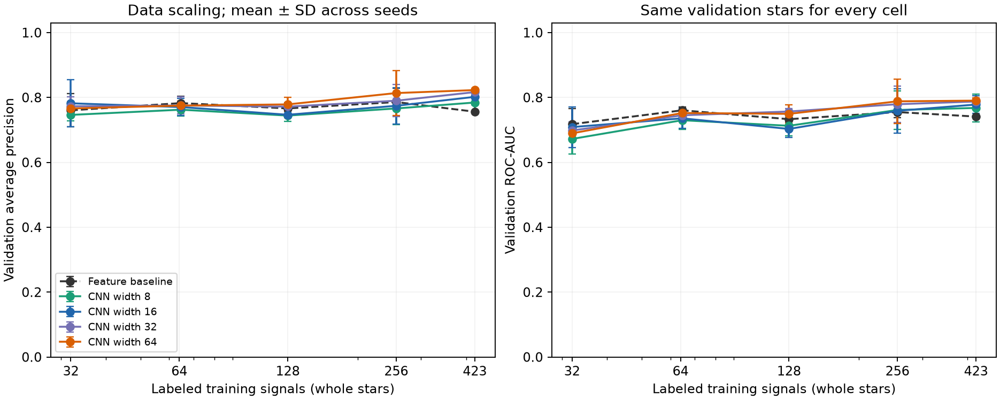
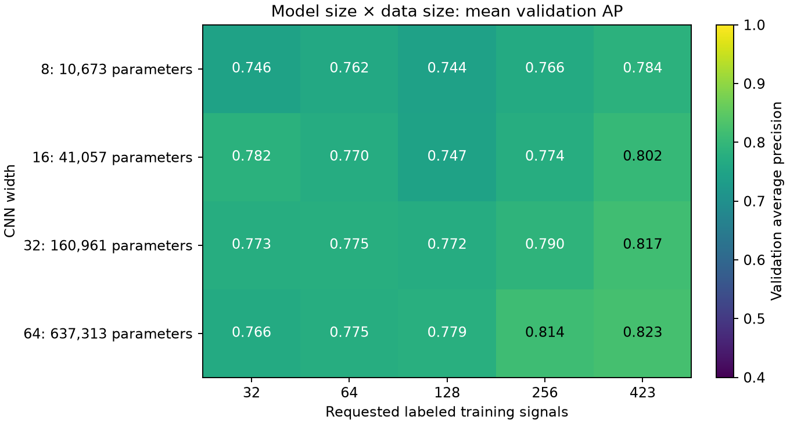
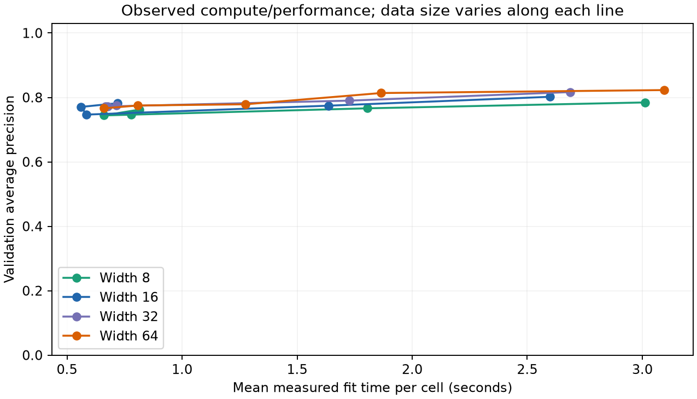
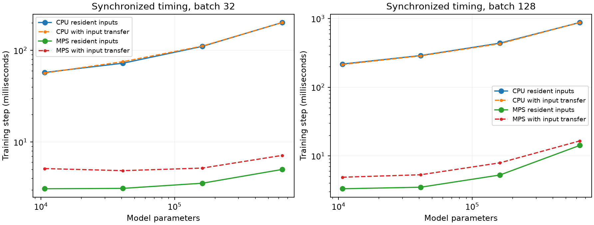

# TESS model/data scaling and Metal experiment

At 423 training signals, CNN width 64 had mean validation AP 0.823, versus 0.756 for the fixed feature baseline. All four CNN sizes beat that baseline on the full pool. Data curves fluctuate at intermediate sizes; they do not show a smooth universal scaling law.

Completed 75 fits: 4 CNN widths plus the feature baseline, 5 nested data levels, and 3 seeds. Validation uses 85 labeled signals on 84 stars (50 CP, 35 FP/FA). The test partition was not evaluated.

The feature baseline is a gradient-boosted decision-tree classifier on period, duration, depth, search strength, signal-to-noise, odd/even and secondary-eclipse measurements, and event counts. CNNs learn from full-orbit, transit-close-up and individual-event views plus four basic measurements.

At the full training pool:

| Model | Training signals (mean) | Validation AP, mean ± SD | ROC-AUC | Recall at validation FPR budget | Mean fit seconds |
| --- | ---: | ---: | ---: | ---: | ---: |
| CNN width 64 | 423 | 0.823 ± 0.004 | 0.790 | 41.3% | 3.1 |
| CNN width 32 | 423 | 0.817 ± 0.010 | 0.788 | 49.3% | 2.7 |
| CNN width 16 | 423 | 0.802 ± 0.025 | 0.778 | 41.3% | 2.6 |
| CNN width 8 | 423 | 0.784 ± 0.032 | 0.768 | 32.7% | 3.0 |
| Feature baseline | 423 | 0.756 ± 0.000 | 0.741 | 12.0% | 2.1 |

Hardware: Apple M5 Pro. CPU timings use four PyTorch threads. Timings include forward, backward, gradient clipping and AdamW, exclude warmup, and explicitly synchronize Metal before and after each timed trial. MPS CPU fallback is disabled. Both resident-input and batch-transfer timings are reported.

| Width | Batch | CPU/MPS resident-step speedup | CPU/MPS with-transfer speedup |
| --- | ---: | ---: | ---: |
| 8 | 32 | 18.7× | 11.1× |
| 8 | 128 | 65.8× | 44.0× |
| 16 | 32 | 23.3× | 15.5× |
| 16 | 128 | 83.1× | 54.2× |
| 32 | 32 | 31.2× | 21.5× |
| 32 | 128 | 83.7× | 54.7× |
| 64 | 32 | 40.3× | 28.2× |
| 64 | 128 | 62.0× | 53.3× |

An additional CPU sweep tested 1, 2, 4 and 8 threads at batch 32:

- Width 16: fastest measured CPU setting was 1 threads (47.3 ms); MPS resident step 3.1 ms (15.2× faster).
- Width 64: fastest measured CPU setting was 1 threads (180.4 ms); MPS resident step 5.0 ms (36.0× faster).

Fixed-epoch full-loop timing includes on-device indexing, validation and checkpoint selection:

- Width 16, 12 epochs, 423 training signals: CPU 8.9s, MPS 1.0s (8.7×).
- Width 64, 12 epochs, 423 training signals: CPU 34.6s, MPS 1.4s (25.6×).

Identical evaluation weights and inputs agreed across CPU/MPS to at most 8.6e-08 absolute logit difference and 5.7e-07 relative L2 gradient difference, with dropout disabled. Training trajectories need not be identical because dropout random generators differ by backend.

## Interpretation and limits

These are validation development curves, not final test results. Error bars are variation across three subset/initialization seeds; they are not population confidence intervals. The available confirmed labels limit the real-data range, and this experiment does not establish an asymptotic scaling law.

At the full pool, parameter count and mean AP increase together over the tested widths. The width-32 model has higher recall at the chosen false-positive budget than width 64, so the best model depends on the intended operating point. The fixed tree baseline's AP decreases from 256 to the full pool. Both the baseline and CNNs would need separate hyperparameter selection for a claim about their best achievable performance.

All cells use learning rate 0.001, batch 32, at most 100 epochs, and patience 20 after at least 25 epochs. The same epoch ceiling gives larger datasets more optimizer updates; exact update counts and measured time are saved so data and optimization effects are visible. Validation AP selects the checkpoint, with validation log loss breaking ties. No model-specific learning-rate sweep was performed.

Each seed defines a nested, approximately class-balanced ordering of whole training stars. All widths and the baseline share each subset; labels and normalization statistics come from training rows only. Adding a multi-signal host can exceed a requested row count slightly. The full training pool is identical across seeds, so its spread primarily reflects initialization and training variation.

CNN cells hitting the epoch cap: 4/60. A cap-hit flag does not establish convergence.

The benchmark and grid use the same photometry representation and architecture. Keeping all training/validation tensors on Metal avoids repeated input transfers. This acceleration concerns CNN training; MAST acquisition, TLS search and the tree baseline still run on CPU.

See [the experiment guide](../../docs/scaling_experiment.md) for reproduction commands.
